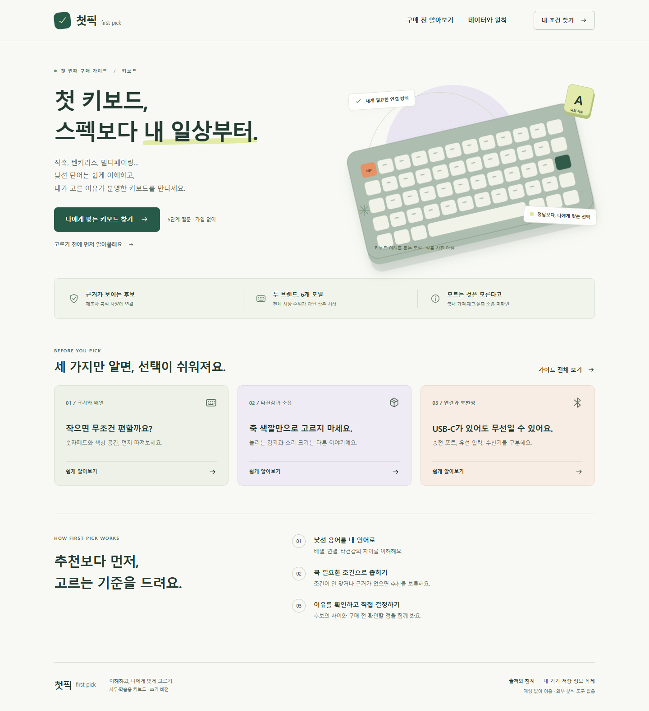

# 첫픽 · First Pick

**처음 사는 키보드, 스펙보다 내 일상부터.**

한국어 구매 입문 가이드와 공식 사양에 근거한 키보드 후보 비교 도구입니다. 사용자가 선택 이유와 아직 확인할 점을 함께 이해하는 것이 목표입니다. 사무·학습용 키보드 6개 모델, 2개 제조사로 시작합니다.



## 실제로 동작하는 기능

- 배열·타건감/소음·연결 방식 입문 가이드와 참고 출처
- 다섯 단계 조건 선택 → 필수 조건 검사 → 후보 최대 3개 우선 표시 / 전체 일치 후보 보기
- 추천 이유별 근거 링크, 검토한 지역·SKU·옵션, 사양 확인일, 구매 전 제약 표시
- 최대 3개 후보 비교, 내 조건과 근거를 포함한 구매 체크리스트 `.txt` 다운로드
- 조건의 브라우저 내 보관·복원·삭제, 저장 차단/손상 시 복구
- 자발적 피드백의 로컬 저장·JSON 내보내기·삭제 (외부 전송 없음)
- 날짜가 잘못되거나 90일이 지난 출처의 후보 보류
- 모바일 레이아웃, 키보드 탐색, 접근 가능한 설명 대화상자

## 제공하지 않는 것

**국내 실시간 가격·배송비·재고, 실측 소음, 직접 사용 리뷰, 시장 전체 순위, 구매 만족 보증은 제공하지 않습니다.** 엄격한 예산 이내 확인 또는 실측 저소음이 필수라면 현재는 추천 결과가 0개이며 이유를 보여줍니다. 조건을 몰래 완화하거나 가격을 만들어내지 않습니다.

글로벌 ANSI 사양과 한국어 SKU를 구분합니다. 글로벌 모델의 국내 판매·한글 각인·보증은 별도 확인이 필요합니다. 키보드 그림은 직접 만든 배열 이해용 도식이며 실제 제품 사진/정확한 키 배치가 아닙니다.

실제 사용자 인터뷰·수요 검증은 **아직 0명**입니다. 자동 테스트나 AI 자체 평가를 사용자 반응으로 계산하지 않습니다. 앱과 코드의 검증은 서비스 수요의 증명이 아닙니다.

## 설치와 실행

검증 환경: Windows 11, Node.js **22.14.0**, npm **10.9.2**, Git **2.48.1**. Node 22.14 이상과 최신 브라우저가 필요합니다. GPU·Python·DB·API 키·별도 가상환경은 필요 없습니다. 의존성은 `package-lock.json`으로 고정합니다.

```sh
git clone https://github.com/mango3461/first-pick.git
cd first-pick
npm ci
npm run dev
```

출력된 로컬 주소를 여세요. 기본은 **http://127.0.0.1:5173/** 입니다. 개발 서버는 기본적으로 내 컴퓨터에서만 접근됩니다. PowerShell이 `npm.ps1`을 차단하면 정책을 바꾸지 말고 `npm.cmd ci`, `npm.cmd run dev`를 사용하세요.

앱 실행에 환경 변수는 필요 없습니다. `.env.example`에는 선택적인 브라우저 테스트 설정만 있습니다. `.env` 파일을 만들거나 토큰을 넣을 필요가 없습니다.

```sh
npm run build
npm run preview
```

프로덕션 정적 파일은 `dist/`에 생성됩니다. 미리보기 기본 주소는 `http://127.0.0.1:4173/`입니다. `index.html` 파일을 직접 더블클릭하지 말고 HTTP 서버를 이용하세요. 명령 실행 터미널에서 Ctrl+C로 중지합니다. 공개 배포는 수행하지 않았습니다.

## 이용 순서

1. 첫 화면의 세 가지 가이드를 읽습니다.
2. ‘나에게 맞는 키보드 찾기’에서 주 기기, 연결, 숫자패드, 사용 습관, 확인 범위를 고릅니다.
3. 후보의 이유·미확인 항목·정확한 옵션을 읽고 공식 출처를 확인합니다.
4. 비교에 최대 3개를 담거나 체크리스트를 저장합니다.
5. 판매처에서 결제 총액·재고·지역별 옵션·반품 조건을 확인한 뒤 결정합니다.

작동 예: Windows / USB 유선 입력 / 숫자패드 무관 / 한 대 / 선호 없음 / 가격·소음 직접 확인 → 검토한 6개 중 Keychron B1 Pro, B6 Pro, V1 Max. 이는 사양 필터 결과이며 가격·성능·가치 순위가 아닙니다. MX Keys S의 USB-C 충전 포트를 유선 입력으로 잘못 처리하지 않습니다.

## 검증 명령

```sh
npm test
npm run check
npm run test:e2e
npm run data:audit
npm run data:links
npm run security:scan
```

- `npm test`: 순수 추천·데이터 테스트. 2,304개 조건 조합의 필수 조건 불변성 포함.
- `npm run check`: JSDoc/TypeScript 정적 타입 검사.
- `npm run test:e2e`: **먼저 빌드한 뒤**, 프로덕션 미리보기 서버를 자동 실행해 Edge/Chromium에서 검사합니다. 1440×1000, 390×844 두 뷰포트, 테스트마다 독립된 브라우저 저장소 사용. 완료하면 테스트 서버는 종료됩니다. 4173 포트가 이미 사용 중이면 먼저 사용 중인 서버를 확인하세요.
- Windows에서는 설치된 Microsoft Edge를 사용합니다. Chromium을 쓰려면 아래 설정을 사용하세요. macOS/Linux 기본은 Playwright Chromium입니다. 그 OS에서의 실행 결과는 아직 확인하지 않았습니다.
- `data:audit`: 현재 KST 날짜에 대해 출처/유효기간/필드 검사. 초기 자료는 2027-02-12부터 재검토가 없으면 실패하도록 설계했습니다.
- `data:links`: URL 응답만 확인. 403/429/타임아웃은 미확인으로 실패하며 우회/무한 재시도하지 않습니다. 사실 검증이나 확인일 자동 갱신이 아닙니다.
- `security:scan`: Git 추적 파일에서 일반적인 비밀 패턴 탐지. 수동 변경 검토를 대체하지 않습니다.

Windows PowerShell에서 Chromium 사용:

```powershell
npx playwright install chromium
$env:PLAYWRIGHT_BROWSER = 'chromium'
npm.cmd run test:e2e
```

Linux/macOS:

```sh
npx playwright install chromium
PLAYWRIGHT_BROWSER=chromium npm run test:e2e
```

테스트 HTML 보고서: `playwright-report/index.html`. 로컬 화면 캡처: `artifacts/qa/`. 실패 추적: `test-results/`. 이 폴더들은 Git에 포함하지 않습니다. 브라우저/다운로드 테스트용 가상 피드백은 실제 사용자 의견이 아닙니다.

## 데이터와 운영 비용

제조사 공개 자료를 수동 확인해 작은 데이터 파일로 관리합니다. 런타임 외부 API·로그인·분석 SDK·유료 서비스·LLM 호출이 없습니다. 새 유료 서비스 사용으로 발생한 비용은 0원입니다. 인터넷·전기·기존 도구 구독료는 별도 계측하지 않았습니다. 향후 배포·도메인·대규모 데이터 확보 비용은 선택 전 승인 대상이며 현재 연결하지 않았습니다.

데이터 갱신은 사람의 시간이 듭니다. 6개 모델을 한 번 확인했을 뿐 월 유지 시간은 아직 측정하지 않았습니다. 자동 링크 검사는 Logitech 3개 200, Keychron 3개 429로 일부 제한됐으며 초기 공식 자료 열람과 구분합니다.

조건과 피드백은 localStorage에만 남습니다. 피드백은 사용자가 저장 버튼을 눌러야 보관되고 최근 20건만 유지합니다. 파일을 내보내도 개발자에게 자동 전송되지 않습니다. 외부 출처 링크를 열면 해당 사이트에 접속합니다. 브라우저 기록/다운로드 파일은 ‘내 기기 저장 정보 삭제’로 삭제되지 않으며 이 버튼은 앱의 두 저장 키만 지웁니다.

## 구조와 문서

```text
src/data/catalog.js       실제 모델·필드별 근거·옵션·확인일
src/engine.js             필수 조건/미확인/선호 정렬 (DOM에 독립)
src/content.js            한국어 질문과 학습 가이드
src/main.js               화면 렌더링·탐색·이벤트·내보내기
src/storage.js            브라우저 저장 실패/복구 처리
src/ui.js / style.css     직접 만든 도식과 반응형 UI
tests/                   단위·브라우저 검증
scripts/                 출처 감사·링크 점검·비밀 패턴 검사
```

- [고정 완료 기준](docs/ACCEPTANCE.md)
- [조사: 확인 사실과 가정](docs/RESEARCH.md)
- [기획·기술·추천 규칙 결정](docs/DECISIONS.md)
- [데이터 갱신 방법](docs/DATA_MAINTENANCE.md)
- [검증 결과와 제한](docs/QA.md)
- [실제 사용자 검증 계획](docs/VALIDATION.md)
- [현재 상태와 다음 작업](docs/STATUS.md)
- [작업 지침](AGENTS.md)

공개 저장소: `mango3461/first-pick`, 브랜치: `main`. 서비스는 미배포 상태입니다.
